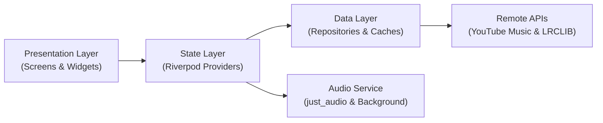

# 🎵 AUNO Music Player

<p align="center">
  
</p>

<p align="center">
  <b>A modern, ad-free music streaming application built with Flutter, powered by YouTube Music and synchronized lyrics.</b>
</p>

<p align="center">
  
  
  
  
  
  
</p>

---

## 📱 Tentang AUNO (About AUNO)

**AUNO** adalah aplikasi pemutar musik modern untuk platform Android dan iOS yang dirancang untuk memberikan pengalaman mendengarkan musik yang mulus, bersih, dan bebas iklan. 

Menggabungkan katalog musik YouTube Music dengan pemutar audio berperforma tinggi, AUNO menghadirkan pemutaran instan (*zero-delay*), lirik berjalan ala karaoke, antarmuka adaptif mengikuti warna sampul album, serta dukungan kontrol media latar belakang penuh.

---

## ✨ Fitur Utama (Features)

* **⚡ Pemutaran Cepat & Tanpa Jeda (*Zero-Delay Playback*)**  
  Ekstraksi audio stream berkecepatan tinggi yang dioptimalkan untuk playback instan (< 500ms) tanpa buffering panjang.

* **🎧 Background Playback & Lock Screen Controls**  
  Musik tetap berputar lancar saat layar ponsel mati atau saat membuka aplikasi lain. Dilengkapi kontrol media lengkap di bar notifikasi dan layar kunci (Play, Pause, Next, Previous, Seek Bar).

* **🎤 Lirik Karaoke Tersinkronisasi (*Time-Synced Lyrics*)**  
  Tampilan lirik berjalan (*karaoke-style*) yang bergulir dan menyorot baris lagu secara otomatis mengikuti ketukan detik lagu secara real-time.

* **🎨 Dynamic Palette Theming**  
  Antarmuka pemutar layar penuh (*Now Playing*) secara cerdas mengekstrak warna dominan dari sampul lagu untuk menghasilkan gradasi warna latar belakang yang hidup dan elegan.

* **🔥 Tangga Lagu & Playlist Pilihan**  
  Menyajikan tangga lagu terpopuler (Top 100 & Trending) serta playlist kurasi tematik (Pop Hits, Viral, Akustik, Mood) dengan tampilan detail playlist lengkap serta opsi **Putar Semua** (*Play All*) dan **Acak** (*Shuffle*).

* **🔍 Pencarian Cepat (*Instant Search*)**  
  Cari lagu, artis, atau album favorit dengan cepat dan langsung putar seketika dari hasil pencarian.

* **❤️ Koleksi Lagu Favorit (*Library*) & Offline-First**  
  Simpan lagu yang disukai (*Liked Songs*) ke penyimpanan lokal. Dilengkapi *caching* lokal agar halaman utama langsung terbuka dalam < 0.2 detik tanpa layar kosong.

---

## 🛠️ Tech Stack & Arsitektur

### Teknologi Utama
* **Framework:** [Flutter](https://flutter.dev) & [Dart](https://dart.dev)
* **State Management:** [Flutter Riverpod](https://pub.dev/packages/flutter_riverpod)
* **Audio Engine:** [just_audio](https://pub.dev/packages/just_audio) & [just_audio_background](https://pub.dev/packages/just_audio_background)
* **Stream & Catalog Extraction:** [youtube_explode_dart](https://pub.dev/packages/youtube_explode_dart) & YouTube Music API
* **Lyrics Provider:** [LRCLIB API](https://lrclib.net/)
* **UI Palette:** [palette_generator](https://pub.dev/packages/palette_generator)
* **Local Storage & Cache:** [shared_preferences](https://pub.dev/packages/shared_preferences) & [cached_network_image](https://pub.dev/packages/cached_network_image)

### Arsitektur Aplikasi
AUNO menerapkan pemisahan tanggung jawab berbasis *Clean Architecture*:



---

## 📁 Struktur Direktori (Project Structure)

```text
lib/
├── core/
│   ├── constants/             # Warna tema, endpoint API, dan konfigurasi umum
│   ├── theme/                 # Dark Theme dan palet dinamis
│   └── utils/                 # Formatter durasi waktu dan pembersih judul lagu
├── data/
│   ├── models/                # SongModel, PlaylistModel, LyricLine
│   └── repositories/          # Implementasi YouTube Music, Audio Stream, Lirik & Storage
├── presentation/
│   ├── providers/             # Notifier audio player, pencarian, dan library
│   ├── screens/
│   │   ├── home/              # Halaman beranda (Charts & Playlist)
│   │   ├── search/            # Halaman pencarian musik
│   │   ├── playlist/          # Halaman detail playlist & aksi putar
│   │   ├── library/           # Daftar lagu yang disukai & playlist lokal
│   │   └── player/            # Full Now Playing Screen & Queue Screen
│   └── widgets/               # Mini Player, Seek Bar, Song Tile, Lirik Karaoke
└── main.dart                  # Titik masuk aplikasi & inisialisasi background service
```

---

## 🚀 Panduan Memulai (Getting Started)

### Prasyarat
- [Flutter SDK](https://docs.flutter.dev/get-started/install) (versi `>= 3.11.4`)
- [Android Studio](https://developer.android.com/studio) / Android SDK (untuk build Android)
- Perangkat Android (OS 8.0 Oreo atau lebih baru) / Emulator

### Langkah Instalasi

1. **Clone repositori:**
   ```bash
   git clone https://github.com/Imamgg/music_app.git
   cd music_app
   ```

2. **Pasang paket dependensi:**
   ```bash
   flutter pub get
   ```

3. **Jalankan unit & widget test:**
   ```bash
   flutter test
   ```

4. **Jalankan aplikasi di mode debug:**
   ```bash
   flutter run
   ```

---

## 📦 Build APK (Production Release)

Untuk mengompilasi file APK rilis siap instal di perangkat Android:

```bash
flutter build apk --release
```

File APK rilis yang dihasilkan tersimpan di:
```text
build/app/outputs/flutter-apk/app-release.apk
```

---

## 📄 Lisensi (License)

Proyek ini dirilis di bawah lisensi **MIT License**. Silakan lihat file `LICENSE` untuk informasi lebih lanjut.
